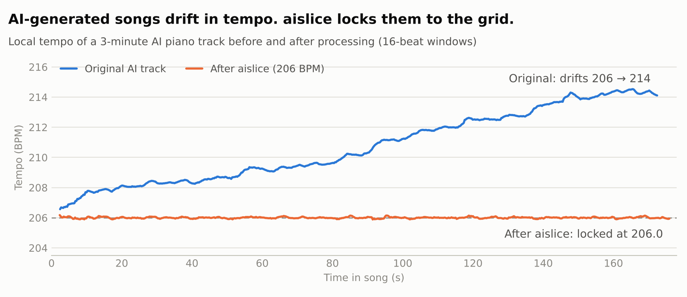

# aislice

[](https://github.com/VNL-Works/ai-music-slicer/actions/workflows/ci.yml)
[](https://pypi.org/project/aislice/)
[](https://github.com/VNL-Works/ai-music-slicer)
[](LICENSE)

**AI songs in, best samples out.** Give `aislice` your AI-generated songs and a BPM; it hands you a folder of the best drum, bass and melody loops, ready to drag into a DAW. Nothing to click or audition in between.

AI music (Suno, Udio, …) rarely holds a steady tempo: it drifts across the song, so it never lines up with a DAW grid. `aislice` tracks every beat, builds a clean tempo map, and time-stretches the song in **one variable-ratio pass**, so every beat lands exactly on the target grid. Pitch is preserved. Then it splits drums, bass and melody, cuts loops and keeps the best ones.

<picture>
  <source media="(prefers-color-scheme: dark)" srcset="docs/tempo-before-after-dark.png">
  
</picture>

> Status: v0.1.0, an early release. Feedback and issues are welcome.

## Install

Requirements: Python 3.10+, [ffmpeg](https://ffmpeg.org), and the [Rubber Band](https://breakfastquay.com/rubberband/) command-line tool.

```bash
# macOS
brew install ffmpeg rubberband
pip install "aislice[all]"          # [all] = stem splitting + bar detection (PyTorch, large)

# or, for development
git clone https://github.com/VNL-Works/ai-music-slicer && cd ai-music-slicer
python3 -m venv .venv && source .venv/bin/activate
pip install -e ".[all,dev]"
```

## Use

```bash
aislice songs/ --bpm 206
```

That's it. For every song it locks the tempo to 206 BPM, splits **drums, bass and melody**, cuts loops and ranks them. The best ones from all the songs of the run land in one folder, named after the date and time of the run:

```
aislice_output/
└── 2026-10-13_1613_206bpm/
    ├── Drums_01_PianoCore_206bpm_Am_4bar25.wav     (4-bar loops)
    ├── Bass_01_PianoCore1_206bpm_Am_4bar12.wav     (4-bar loops)
    ├── Melody_01_PianoCore1_206bpm_Am_8bar02.wav   (8-bar loops)
    ├── … _02 … _08 for each instrument
    └── best.json
```

- **01 = best.** Ranking: not "quiet" (leftover bleed from the splitter), then most repeated (in AI songs the part that keeps coming back is usually the hook), then fullest. Ranked across all songs of the run. `--best 12` keeps 12 per instrument (default 8).
- **Fixed loop sizes:** drums and bass are 4-bar loops, melody 8-bar loops. Every file is exactly that long, so it sits on the DAW grid.
- **Normalized:** every file peaks at −0.1 dB on its own. Near-silent slices are never boosted, so silence never turns into hiss.
- **Tempo inside:** each loop has the BPM in its name and in an ACID chunk, and the key (a guess) when it's confident.
- **Nothing else is left behind.** The working files (the locked song, stems, every loop) are deleted once the best loops are saved. Each run gets its own folder, so runs never mix.

Stem splitting is slow on a CPU: roughly 4× the song length (a 3-minute song ≈ 12 minutes). Apple Silicon and NVIDIA GPUs are much faster.

### Under the hood

**Bar detection:** with the `[beats]` extra (included in `[all]`), [beat_this](https://github.com/CPJKU/beat_this) decides which beat is bar 1; aislice's own beat grid does the precise timing. If beat_this is unsure, a built-in harmony rule decides.

**Stems:** separation runs after the tempo is locked, so every stem lines up sample-exactly with the mix. The model is **BS-Roformer-SW** (6 stems, merged into drums / bass / melody), which won our listening test against Demucs `htdemucs_ft` and `htdemucs`. Models download once to `~/.cache/aislice/models` (about 700 MB). Check the model's license before commercial use.

### Fixing a wrong bar start

If slice 1 doesn't start on the "1", move the bar start without re-processing:

```bash
aislice reslice "aislice_output/.work_…/song_206bpm" --shift 2   # with --keep-work: bar 1 = 2 beats later
```

`aislice` prints a warning when it isn't sure where bar 1 is.

### Optional: hand-pick (Picker)

Only if you want to audition loops yourself. The Picker needs the working files, so keep them for that run:

```bash
aislice songs/ --bpm 206 --keep-work
aislice pick aislice_output/.work_2026-10-13_1613_206bpm/
```

A local page in your browser (nothing is uploaded). It opens on **★ Best of all songs**: the top loops per instrument across every song, ranked like the main output. Click a song on the left for its full grid, drawn to time (an 8-bar melody box is as wide as two 4-bar drum boxes). Empty slices are hidden, repeats share a tint, and the full mix row is hidden (`M` shows it).

Keys: arrows move · `Space` plays (gapless loop) · `K` keep (group's best) · `Shift+K` keep the whole group · `S` skip the group · `U` undo · `A` play all stems at that spot, `1`–`9` mute stems · `B` Best/All · `C` compact · `E` show empty. **Export** copies your keeps to `aislice_output/_ready/` (same names, normalized, ACID tempo). Picks are saved in `_ready/picks.json` as you go. `aislice pick --auto --best 6` does it without the browser.

### Optional: jam (launchpad)

```bash
aislice jam aislice_output/.work_2026-10-13_1613_206bpm/   # needs --keep-work, like the Picker
```

A launchpad in your browser. Every stem is a column of pads, filled with the best loops from all your songs at the same BPM (the most repeated parts first, empty slices left out). Click a pad and it starts on the next bar, in sync with everything else. Click it again to stop. One pad per column plays at a time, so you can put the drums of one song under the melody of another.

- Press **Record**, play, press it again: the jam is saved to `_ready/jams/Jam_<time>_<bpm>bpm/` as a mix plus one WAV per column, all starting on bar 1, normalized, with the tempo inside. Drag them into your DAW as a finished arrangement.
- What you hear is what gets saved: the recording is rendered sample-exact from the original slices, not captured from the speakers.
- Drums and bass pads loop every 4 bars, melody every 8, all phrase-aligned. Volume slider and **M** (mute) per column, **■** stops a column at the next bar. Song chips turn songs on and off; "+ more" shows every loop.
- Keys: `Space` play/stop, `R` record, `Esc` stop all pads.

## How it works

1. **Analyze**: high-resolution onset envelope (~3 ms frames) and a local tempo curve, then a dynamic-programming beat tracker whose expected period follows the song's drift.
2. **Calibrate**: beat markers are aligned to the actual note attacks, so slices start just before each transient.
3. **Clean the tempo map**: fix missed and extra beats, ignore weak beats in fade-ins and fade-outs, and smooth out tracking jitter while keeping real drift. Then find the bar downbeat.
4. **Warp**: one Rubber Band R3 pass with a time map (source beat → target grid line), with the first downbeat placed on a bar line.
5. **Slice** at exact grid positions, then **verify** by re-tracking the output.

## Development

```bash
pip install -e ".[dev]"
pytest
```

The tests build synthetic songs with a known, drifting tempo and chords that change on each bar. That gives exact ground truth for beat timing, downbeat detection, slicing and the full end-to-end run. The end-to-end test needs `rubberband` and `ffmpeg` installed and is skipped otherwise. CI runs everything on Python 3.10–3.13 and on macOS, plus a job that runs the real Demucs and beat_this models. See [AGENTS.md](AGENTS.md) for architecture and invariants, and [CHANGELOG.md](CHANGELOG.md) for releases.

## License

[MIT](LICENSE) © VNL Works

`aislice` calls the [Rubber Band](https://breakfastquay.com/rubberband/) command-line tool as a separate program. Rubber Band itself is GPL-2.0+ (commercial licenses are available from its authors) and is installed separately.
